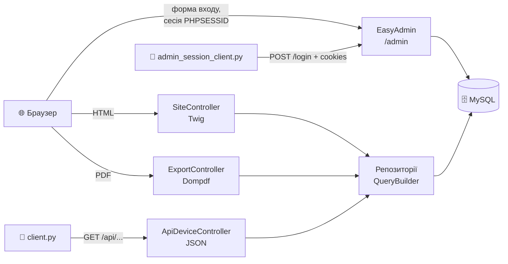
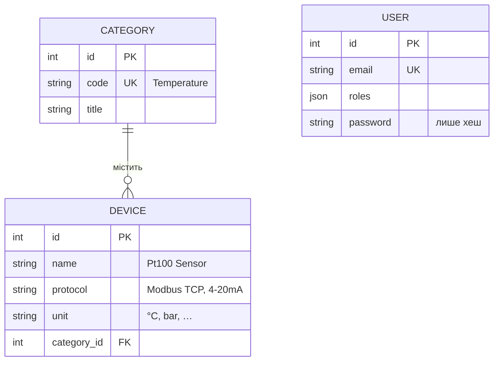

<div align="center">

# ⚙️ SCADA Device Registry

**Реєстр пристроїв SCADA на Symfony: сайт на Twig, JSON API, PDF-звіт, адмінка EasyAdmin і Python-клієнти**


</div>

---

## 📖 Тема

Атестація-2 з курсу «Серверні веб-технології». Продовження Атестації-1 (PHP API + Python-клієнт для обладнання SCADA): той самий реєстр промислових пристроїв, але тепер це повноцінний вебсервіс на Symfony.

- **Категорія → Пристрої**: дві пов'язані сутності Doctrine (`Category` 1 — N `Device`), таблиці створюють міграції.
- **Сайт на Twig**: реєстр пристроїв з фільтром за категорією та пошуком, сторінка категорії `/category/{code}` і сторінка пристрою `/device/{id}`.
- **Адмінка EasyAdmin**: CRUD для категорій і пристроїв, закрита входом (`ROLE_ADMIN`).
- **JSON API**, який читає консольний Python-клієнт (як в Атестації-1).
- **Бонуси**: Python-клієнт входить в адмінку через сесію (як у демо з лаби 12), валідація полів, пошук і фільтр через QueryBuilder, експорт реєстру в PDF (Dompdf).

## 🏗 Архітектура



### Схема бази даних



`Device.category` — це `ManyToOne`, `Category.devices` — зворотний `OneToMany` (з `orphanRemoval`). Структуру створюють міграції з теки `migrations/`: ручного SQL у проєкті немає.

## 🚀 Як запустити

### Вимоги

- PHP ≥ 8.4 з розширеннями `pdo_mysql`, `intl`, `ctype`, `iconv`
- [Composer](https://getcomposer.org/download/)
- MySQL 8 або MariaDB (наприклад, з [Laragon](https://laragon.org/))
- [Symfony CLI](https://symfony.com/download) — за бажанням, для `symfony serve`
- Python ≥ 3.10

### Кроки

```bash
git clone https://github.com/Asay-hub/scada-php-api-lab.git
cd scada-php-api-lab

# 1. Залежності
composer install

# 2. Підключення до MySQL — у .env.local (файл не комітиться)
echo 'DATABASE_URL="mysql://root:@127.0.0.1:3306/scada?serverVersion=8.0.32&charset=utf8mb4"' > .env.local

# 3. База і таблиці — міграціями
php bin/console doctrine:database:create --if-not-exists
php bin/console doctrine:migrations:migrate --no-interaction

# 4. Адміністратор: email і пароль питає консоль, пароль вводиться приховано
php bin/console app:admin:create

# 5. Сервер
symfony serve
# або без Symfony CLI:
php -S 127.0.0.1:8000 -t public
```

> У `.env` за замовчуванням лишився рядок PostgreSQL із рецепта Symfony, а міграції згенеровані під MySQL. Тому `DATABASE_URL` обов'язково задається в `.env.local`, як у кроці 2.

Після запуску база порожня: додайте категорії та пристрої через адмінку (`/admin`), і вони одразу з'являться на сайті й в API.

| Адреса | Що там |
|--------|--------|
| http://127.0.0.1:8000/ | реєстр пристроїв, фільтр за категорією, пошук |
| http://127.0.0.1:8000/category/Temperature | пристрої однієї категорії |
| http://127.0.0.1:8000/device/1 | сторінка одного пристрою |
| http://127.0.0.1:8000/export/pdf | завантаження реєстру у PDF |
| http://127.0.0.1:8000/api/categories | JSON API |
| http://127.0.0.1:8000/admin | адмінка (спершу відкриється `/login`) |

## 🔌 JSON API

| Метод | URL | Опис |
|-------|-----|------|
| `GET` | `/api/categories` | список категорій (код і назва) |
| `GET` | `/api/devices` | усі пристрої |
| `GET` | `/api/devices/{code}` | пристрої категорії за кодом (`404`, якщо немає) |

Параметри `/api/devices` (можна комбінувати):

| Параметр | Приклад | Опис |
|----------|---------|------|
| `category` | `?category=Temperature` | фільтр за кодом категорії |
| `q` | `?q=Pt100` | пошук у назві та протоколі |

```bash
curl "http://127.0.0.1:8000/api/devices/Temperature"
```

Приклад відповіді (дані залежать від того, що додано в адмінці):

```json
{
    "category": "Temperature",
    "title": "Датчики температури",
    "devices": [
        {
            "id": 1,
            "name": "Pt100 Sensor",
            "protocol": "4-20mA",
            "unit": "°C"
        }
    ]
}
```

Для неіснуючої категорії API повертає `404` з `{"error": "Категорію «…» не знайдено"}`.

## 🐍 Python-клієнти

Обидва клієнти використовують бібліотеку `requests`:

```bash
python3 -m pip install requests
```

### `client.py` — читає JSON API

Послідовно виконує чотири запити й друкує відповіді: список категорій, пристрої першої категорії, усі пристрої та запит до неіснуючої категорії (перевірка `404`).

```bash
python3 client.py
```

### `admin_session_client.py` — входить в адмінку через сесію

1. `GET /admin` без входу → `302` на `/login`.
2. `GET /login` → розбирає форму входу і бере приховане поле `_csrf_token`.
3. `POST /login` з email, паролем і токеном. Заголовки `Origin` і `Referer` потрібні для stateless CSRF-перевірки Symfony. Після успіху сервер запам'ятовує вхід у сесії, клієнту лишається cookie `PHPSESSID`.
4. Тією ж `requests.Session()` відкриває `/admin` і перевіряє, що показано панель EasyAdmin і поточного адміністратора.

Пароль запитує `getpass` (не відображається і ніде не зберігається).

```bash
python3 admin_session_client.py
```

## 🛡 Безпека

- Адмінку закриває правило `access_control` для `^/admin` у `config/packages/security.yaml` (потрібна роль `ROLE_ADMIN`).
- Паролі зберігаються лише як хеш (`password_hashers: auto`). Адміністратора створює консольна команда `app:admin:create`, тож пароля немає ні в коді, ні в репозиторії. Пароль краще не передавати аргументом команди, щоб він не потрапив в історію терміналу: без аргументу команда питає його приховано.
- CSRF-токени у формі входу (`enable_csrf: true`) і у формах EasyAdmin.
- `.env.local`, `vendor/` і `var/` — у `.gitignore`.

## ✅ Валідація

Правила описані атрибутами `Assert` на сутностях і діють у формах адмінки:

- **Category**: код 2–30 символів і унікальний (`UniqueEntity`), назва 2–100 символів.
- **Device**: назва 2–100 символів, протокол 2–50 символів, одиниці вимірювання до 20 символів, категорія обов'язкова.

Помилки показуються українською під полями форми.

## 📁 Структура

```
├── admin_session_client.py    # вхід в адмінку через сесію
├── client.py                  # консольний клієнт JSON API
├── bin/console
├── config/                    # security.yaml, csrf.yaml, doctrine.yaml, маршрути EasyAdmin, …
├── migrations/                # messenger, category + device, user
├── public/index.php           # єдина точка входу
├── src/
│   ├── Command/               # app:admin:create
│   ├── Controller/
│   │   ├── Admin/             # DashboardController, CategoryCrudController, DeviceCrudController
│   │   ├── ApiDeviceController.php
│   │   ├── ExportController.php
│   │   ├── SecurityController.php
│   │   └── SiteController.php
│   ├── Entity/                # Category, Device, User
│   └── Repository/            # QueryBuilder: findByFilter(), findAllOrdered()
└── templates/                 # base, site/index, site/category, site/device, security/login
```

## 🛠 Технології

PHP 8.4 · Symfony 8.1 · Doctrine ORM і Migrations · Twig · EasyAdmin 5 · Dompdf · MySQL · Python (requests)
